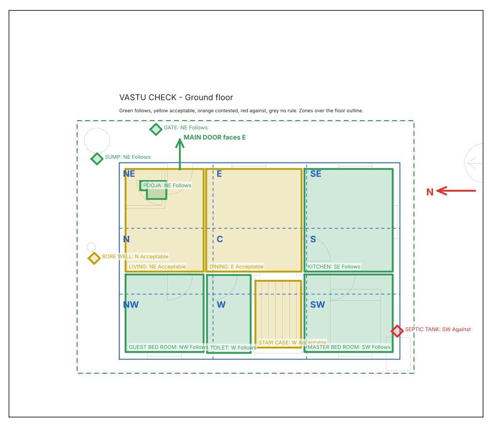
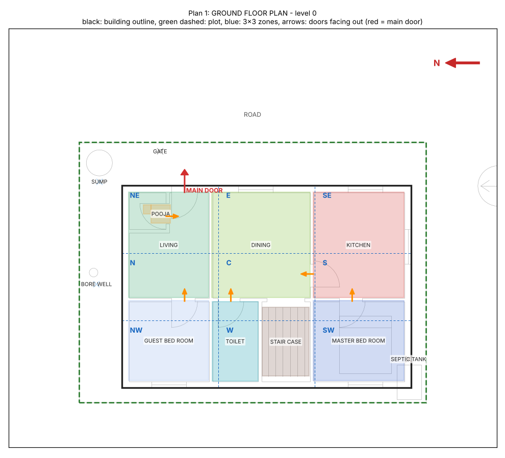

# Vastu Checker for CAD plans

Checks a house plan against Vastu Shastra straight from its AutoCAD drawing. It reads the rooms, their written sizes, the doors, the north arrow and the plot out of a DWG or DXF file, checks each placement against the classical rules, and draws the result back onto the plan as DWG, DXF, PDF and PNG.

It is an [Agent Skill](vastu-checker/SKILL.md) for Claude, and its scripts also run on their own from the command line.



> **Status: alpha.** Tested on synthetic drawings (in `tests/`) and on one real office drawing set in AutoCAD 2004 format. Drawings from other offices will find gaps; see [Contributing](CONTRIBUTING.md).

## What it does

- **Reads DWG and DXF** in pure Python, with no CAD software or native libraries: DWG in the AutoCAD 2000, 2004, 2010, 2013 and 2018 formats (2018 is the default for AutoCAD 2018 and later), and ASCII DXF from R12 on.
- **Finds every floor plan** in a drawing set, names its level from its title (stilt, ground, first, typical, terrace), and flags plans that exist in several versions.
- **Places each room** by fitting the size written on its label (12'0"X14'6", 3.0X3.6, 3600X3000) to the walls around it, or by the space around the label when no size is given. Stairs come from their tread lines.
- **Reads the doors** from their swing arcs, with the main door from its tag (MD, DM or MAIN DOOR), which way it faces and the spaces it joins.
- **Finds the plot and building outline**, the road side, site items (gate, sump, borewell, septic tank, overhead tank, parking) and north (compass rose, north arrow or north block).
- **Checks** zones, the main door, stairs, the centre, proportions, open space and roads against the rules in [`references/vastu-rules.md`](vastu-checker/references/vastu-rules.md). Rules on which the classical texts disagree are marked *contested*, with both readings.
- **Draws the result** in the drawing's own coordinates on separate layers (`VASTU-GRID`, `VASTU-STATUS` and so on), so the DWG lines up when attached onto the original at 0,0.

Before anything is checked, it writes a picture of what it read, so a wrong north or a misread room is caught first:



## Use it with Claude

Add the `vastu-checker` folder to Claude as a skill: build it with `python3 tools/build_skill.py` (it writes `dist/vastu-checker.skill`), or download that file from the Releases page. Then share a DWG or DXF and ask for a Vastu check. Claude reads the drawing, shows what it read, asks about anything uncertain (north, the final version of a plan), and returns the report with the marked-up drawing.

## Use it from the command line

Python 3.10 or later, with `numpy` and `matplotlib` (`scipy` makes it faster, but isn't needed):

```bash
pip install -r requirements.txt
python3 vastu-checker/scripts/cad_plan.py docs/example_house.dxf --out out      # read the drawing
python3 vastu-checker/scripts/vastu_check.py out/example_house_plan.json        # check it (--manaiyadi for room sizes)
python3 vastu-checker/scripts/vastu_overlay.py out/example_house_plan.json --drawing docs/example_house.dxf --out out
```

`cad_plan.py` writes `<name>_plan.json` (the [plan format](vastu-checker/references/plan-format.md)), `<name>_read.png` and, for drawing sets, `<name>_plans.png` with every plan numbered. If something was read wrongly, rerun with `--plans`, `--up` or `--units`, or edit the plan file, then run the check and the overlay. [`references/cad-input.md`](vastu-checker/references/cad-input.md) explains how the reader works and how to correct it.

Plans without a CAD file work too: describe the rooms in the plan format and run `vastu_check.py` on it, or use `vastu_check.py --zoning --up N` for the ideal zoning map.

## On Vastu

The rules here are a traditional practice, not engineering or science, and the skill says so. It reports what the classical sources hold, ranks the issues, prefers design fixes that keep the house working well, and is plain about trade-offs with daylight, ventilation and structure. It leaves out predictions of misfortune and the parts of the texts that aren't design decisions. Schools differ on details; `scripts/zone_rules.json` can be edited to follow another.

## Limits

- Rooms and outlines are read as rectangles; curved and angled walls come out as their bounding boxes.
- Room names are recognised from an English vocabulary common in Indian drawings (POOJA, SIT-OUT, M.BED ROOM, U.G.SUMP...). Other names and scripts need adding to `scripts/cad_labels.py`.
- AutoCAD 2007-format DWG, binary DXF and external references aren't read.
- Floor levels, slopes, roof falls and ceiling heights aren't in a plan drawing; the report asks for them.

## Tests

```bash
python3 tests/test_skill.py      # or: python3 -m pytest tests
```

The tests write the same synthetic house as a metric DXF with a north-arrow block, a feet-and-inch DXF with compass letters and a gate gap, and a metric DWG, and check that all three read the same.

## Credits and notices

- The DWG reader follows the Open Design Alliance's published *Open Design Specification for .dwg files*.
- The DWG writer (`scripts/dwg_write.py`) builds files on `assets/dwg_template.json`: the layer, linetype, text-style and layout set of a house drawing, with no drawn content. Files it writes say they come from this writer.
- AutoCAD and DWG are trademarks of Autodesk, Inc. This project is not affiliated with Autodesk or the Open Design Alliance.

## License

[MIT](LICENSE)
